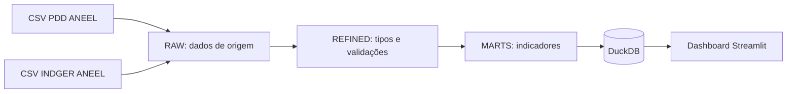

# GridInvest Analytics

O **GridInvest Analytics** analisa os investimentos das distribuidoras de energia elétrica no Brasil a partir de dados públicos da ANEEL. O dashboard compara valores planejados e realizados, acompanha investimento por unidade consumidora e mostra como os recursos se distribuem entre tipos de obra.

**Dashboard público:** [gridinvestanalytics.streamlit.app](https://gridinvestanalytics.streamlit.app/)

## Fontes e licença dos dados

- [PDD — Plano de Desenvolvimento da Distribuição](https://dadosabertos.aneel.gov.br/dataset/pdd)
- [INDGER — Indicadores Gerenciais da Distribuição](https://dadosabertos.aneel.gov.br/dataset/indger-indicadores-gerenciais-da-distribuicao), em particular [INDGER — Dados Comerciais (CSV)](https://dadosabertos.aneel.gov.br/dataset/indger-indicadores-gerenciais-da-distribuicao/resource/fd10c9d4-cb76-4020-a322-e79afb13eaf7)

As páginas da ANEEL indicam a [Open Data Commons Open Database License (ODbL) 1.0](https://opendatacommons.org/licenses/odbl/1-0/) para esses conjuntos. Atribuição: **Dados: ANEEL, PDD e INDGER — Dados Comerciais.** O banco derivado de publicação inclui os links das fontes e da licença no aviso de atribuição; os metadados das tabelas registram as fontes e a licença. A redistribuição de bancos derivados deve observar os termos de atribuição e compartilhamento da ODbL; consulte a licença para as condições completas. A atribuição não implica endosso pela ANEEL.

## Arquitetura



- **RAW** preserva os registros e campos de origem.
- **REFINED** converte campos definidos pelo projeto e sinaliza valores nulos ou inválidos.
- **MARTS** prepara coorte, rankings e indicadores analíticos em SQL.
- **Dashboard** consulta as tabelas MARTS em modo somente leitura. Na nuvem, usa o banco reduzido de publicação; localmente, usa `gridinvest.duckdb` por padrão.

## Páginas do dashboard

As páginas compartilham o filtro de ano (2023, 2024 e 2025) e uma coorte fixa das dez distribuidoras com mais unidades consumidoras ativas em dezembro de 2025.

1. **Visão Geral** — mostra totais planejados e realizados, taxa de execução e quantidade de distribuidoras. Compara o ranking financeiro por distribuidora e a composição em Expansão, Melhoria e Renovação.
2. **Comparativo Top 10** — ordena as dez distribuidoras por investimento realizado por unidade consumidora (R$/UC) e apresenta detalhes de investimento, posições, unidades consumidoras e execução financeira.
3. **Investimento por UC** — apresenta maior e menor R$/UC, UCs ativas e indicador agregado da coorte (investimento total dividido pelo total de UCs), além de ranking em barras, dispersão e tabela.
4. **Planejado x Realizado** — compara totais planejados e realizados, percentual de execução e diferenças absoluta e percentual, por distribuidora.
5. **Perfil de Investimentos** — mostra totais e composição por Expansão, Melhoria, Renovação e outros tipos, com participação e comparativos por distribuidora.

Os cálculos mantêm escopos nacional e `top10` separados. Valores ausentes, inválidos ou com cobertura incompleta são indicados como indisponíveis, e não como zero. Um zero válido permanece distinto de um valor ausente. R$/UC mede intensidade de investimento por unidade consumidora; não representa eficiência operacional nem valor recebido individualmente pelos consumidores.

## Tecnologias

- Python 3.12 ou superior e [uv](https://docs.astral.sh/uv/) para ambiente e dependências.
- DuckDB para armazenamento e consultas analíticas.
- Streamlit para o dashboard; Pandas e Altair para tabelas e visualizações.
- SQL para construção dos MARTS; pytest e Ruff para testes e análise estática.

As dependências diretas e suas versões resolvidas estão declaradas em `pyproject.toml` e `uv.lock`.

## Estrutura principal

```text
assets/logos/       marcas institucionais e logos de distribuidoras
dashboard/          aplicação Streamlit, páginas, acesso a dados e visuais
pipeline/           ingestão e transformações RAW/REFINED/MARTS
raw/                arquivos CSV de entrada locais (não versionados)
scripts/            geração do banco reduzido para publicação
specs/              especificações do pipeline e do dashboard
sql/marts/          consultas de criação dos MARTS
tests/              testes automatizados
artifacts/deploy/   banco reduzido local (ignorado pelo Git)
```

## Executar localmente

Pré-requisitos: Python 3.12 ou superior e `uv`. Na raiz do repositório, instale as dependências:

```powershell
uv sync --all-groups
```

Para executar o dashboard com o banco de desenvolvimento `gridinvest.duckdb` na raiz:

```powershell
uv run python -m streamlit run dashboard/app.py
```

O pipeline lê `raw/pdd-distribuicao-aneel.csv` e `raw/indger-dados-comerciais.csv`; os arquivos de origem precisam ser obtidos nos portais da ANEEL. O projeto não os baixa automaticamente. Execute as etapas na ordem indicada:

```powershell
uv run python -m pipeline.ingestao
uv run python -m pipeline.ingestao_indger
uv run python -c "from pipeline.refined import transformar_pdd, transformar_indger; transformar_pdd(); transformar_indger()"
uv run python -c "from pipeline.marts import executar_mart_01, executar_mart_02, executar_mart_03, executar_mart_04, executar_mart_05, executar_mart_06, executar_mart_07, executar_mart_08; [f() for f in (executar_mart_01, executar_mart_02, executar_mart_03, executar_mart_04, executar_mart_05, executar_mart_06, executar_mart_07, executar_mart_08)]"
```

Para executar a suíte de testes e o Ruff:

```powershell
uv run python -m pytest
uv run ruff check .
```

## Banco DuckDB e dados locais

`gridinvest.duckdb` é criado pelo pipeline e não é versionado. Não o adicione ao repositório. O arquivo original contém camadas RAW e REFINED que não são necessárias ao dashboard publicado.

Para gerar o banco reduzido, com apenas as tabelas MARTS necessárias às cinco páginas:

```powershell
uv run python scripts/build_dashboard_db.py
```

O script lê a origem em modo somente leitura e salva `artifacts/deploy/gridinvest_dashboard.duckdb` com seu aviso de atribuição. A pasta `artifacts/` e bancos DuckDB estão ignorados pelo Git.

## Streamlit Community Cloud

O dashboard está publicado em [gridinvestanalytics.streamlit.app](https://gridinvestanalytics.streamlit.app/). O projeto usa Python 3.12 e o Community Cloud instala as dependências resolvidas em `uv.lock`.

O banco local de desenvolvimento não é publicado. O banco reduzido de publicação contém somente as tabelas necessárias do schema MARTS, sem RAW ou REFINED. Para atualizar esse banco, gere e valide o artefato localmente, calcule seu SHA-256 e anexe o banco e o aviso de atribuição a uma **GitHub Release**. Depois de criar a release, configure o endereço HTTPS real do asset e o hash aprovado nos Secrets do app do Streamlit Cloud. Não há URL fixa de release neste README; use a URL do asset que efetivamente foi publicado.

| Variável | Funcionamento |
|---|---|
| `GRIDINVEST_DB_URL` | URL HTTPS do banco de publicação. Quando definida, o app baixa o arquivo para o diretório temporário do sistema, fora do repositório. |
| `GRIDINVEST_DB_SHA256` | SHA-256 hexadecimal esperado; obrigatório com `GRIDINVEST_DB_URL`. O app valida o arquivo antes de consultá-lo. |
| `GRIDINVEST_DB_PATH` | Caminho opcional para selecionar um banco local alternativo, por exemplo o artefato reduzido em `artifacts/deploy/`. Não realiza download. |

No modo local padrão, sem `GRIDINVEST_DB_URL` ou `GRIDINVEST_DB_PATH`, o app usa `gridinvest.duckdb` e não faz download. No Community Cloud, configure `GRIDINVEST_DB_URL` e `GRIDINVEST_DB_SHA256` como Secrets de nível raiz; o Streamlit os expõe como variáveis de ambiente. O acesso ao banco é somente leitura. Não coloque URLs privadas, credenciais ou arquivos DuckDB no Git.

Para testar localmente o banco reduzido antes de publicá-lo:

```powershell
$env:GRIDINVEST_DB_PATH = (Resolve-Path .\artifacts\deploy\gridinvest_dashboard.duckdb).Path
uv run python -m streamlit run dashboard/app.py
```

## Período de referência e limitações

- Os anos exibidos são 2023, 2024 e 2025; a coorte é fixa pela quantidade de UCs ativas em dezembro de 2025, não um ranking recalculado para cada ano.
- Os dados e formatos dependem das publicações da ANEEL. Novas cargas devem ser conferidas contra o esquema esperado pelo pipeline.
- CSVs de entrada e o banco local não acompanham o clone; cada ambiente que for executar o pipeline precisa obter as fontes e preparar seus próprios dados.
- Ausências, duplicidades, valores inválidos e cobertura incompleta na origem podem deixar indicadores indisponíveis.
- A UF e a região exibidas são referências principais da concessão, não a lista completa de municípios atendidos.
