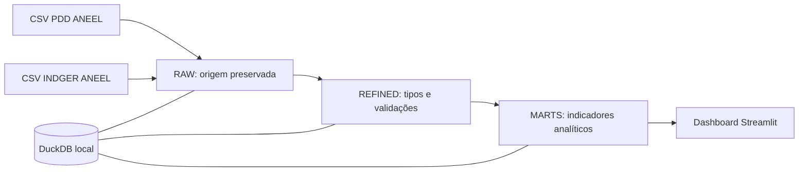

# GridInvest Analytics

**GridInvest Analytics** é um projeto de análise de dados públicos sobre os
investimentos das distribuidoras de energia elétrica no Brasil. O objetivo é
comparar valores planejados e realizados, acompanhar o investimento por unidade
consumidora e explorar como os recursos são distribuídos entre tipos de obra.

As análises combinam informações do **Plano de Desenvolvimento da Distribuição
(PDD)** e do **INDGER – Dados Comerciais**, publicados pela Agência Nacional de
Energia Elétrica (ANEEL):

- [PDD – Plano de Desenvolvimento da Distribuição](https://dadosabertos.aneel.gov.br/dataset/pdd)
- [INDGER – Indicadores Gerenciais da Distribuição](https://dadosabertos.aneel.gov.br/dataset/indger-indicadores-gerenciais-da-distribuicao), em particular o recurso [INDGER – Dados Comerciais](https://dadosabertos.aneel.gov.br/dataset/indger-indicadores-gerenciais-da-distribuicao/resource/fd10c9d4-cb76-4020-a322-e79afb13eaf7)

Consulte os metadados e a licença apresentados pela ANEEL para cada conjunto de
dados antes de redistribuir cópias. Os conjuntos consultados indicam licença
ODbL.

## Arquitetura



- **RAW:** importa os CSVs sem descartar linhas e mantém os campos de origem
  como texto.
- **REFINED:** converte campos definidos pelo projeto, preserva valores de
  origem relevantes e sinaliza valores nulos ou inválidos.
- **MARTS:** produz oito artefatos SQL para indicadores, coorte, rankings,
  investimento por unidade consumidora, execução financeira, evolução e perfil
  por tipo.
- **Dashboard:** lê os MARTS do DuckDB em modo somente leitura.

A análise principal cobre os anos de referência **2023 a 2025** e usa uma
coorte fixa das dez distribuidoras com mais unidades consumidoras ativas em
dezembro de 2025.

## Páginas do dashboard

1. **Visão Geral** — resume investimento planejado e realizado, execução e
   distribuidoras da coorte; compara o ranking financeiro e a composição por
   Expansão, Melhoria e Renovação.
2. **Comparativo Top 10** — apresenta o ranking de investimento realizado por
   unidade consumidora (R$/UC) e cards comparativos individuais para as dez
   distribuidoras.
3. **Investimento por UC** — compara R$/UC, unidades consumidoras e investimento
   total por distribuidora, com KPIs da coorte, ranking em barras, dispersão e
   tabela.
4. **Planejado x Realizado** — compara os valores planejados e realizados,
   percentual de execução e diferenças por distribuidora, com gráfico de colunas
   agrupadas e tabela.
5. **Perfil de Investimentos** — explora os totais e a composição por tipo, com
   gráficos de participação e comparação entre distribuidoras.

As páginas mantêm os escopos nacional e `top10` separados. Valores nulos,
inválidos ou com cobertura incompleta são tratados como indisponíveis, não como
zero. Um zero válido continua distinto de um valor ausente.

## Tecnologias

- Python **3.12 ou superior**, conforme `pyproject.toml`.
- [uv](https://docs.astral.sh/uv/) para ambiente e dependências (`uv.lock`).
- Streamlit para a aplicação web e Altair/Pandas para visualizações e tabelas.
- DuckDB para armazenamento e consultas analíticas locais.
- SQL para a construção dos MARTS.
- pytest e Ruff para testes e análise estática.

As versões mínimas declaradas pelo projeto são DuckDB `>=2.0.0` e Streamlit
`>=1.66.1`. pytest e Ruff estão no grupo de dependências de desenvolvimento.

## Estrutura do projeto

```text
.
├── assets/logos/       # Logos das distribuidoras e marca do dashboard
├── dashboard/          # Aplicação Streamlit, páginas, dados e visualizações
├── pipeline/           # Ingestão, transformação REFINED e execução dos MARTS
├── raw/                # CSVs locais de entrada; não versionados
├── specs/              # Especificações das camadas e do dashboard
├── sql/marts/          # SQL da coorte e dos MARTS 01 a 08
├── tests/              # Testes de ingestão, transformações, MARTS e dashboard
├── .streamlit/         # Configuração visual local do Streamlit
├── pyproject.toml      # Dependências e configuração do pytest
├── uv.lock             # Resolução travada das dependências
└── gridinvest.duckdb   # Banco local, gerado durante a preparação dos dados
```

## Preparação local

Pré-requisitos: Python 3.12 ou superior e `uv` instalado. Na raiz do repositório,
instale as dependências principais e de desenvolvimento:

```powershell
uv sync --all-groups
```

Crie a pasta local e baixe os arquivos CSV nos portais oficiais da ANEEL:

```powershell
New-Item -ItemType Directory -Force raw
```

Coloque os arquivos com estes nomes em `raw/`:

- `pdd-distribuicao-aneel.csv`
- `indger-dados-comerciais.csv`

A pasta `raw/` pode precisar ser criada localmente. Os scripts não fazem o
download automático desses arquivos.

Antes de carregar o PDD, confira o cabeçalho do arquivo baixado. A ingestão atual
espera 12 colunas, incluindo `_id`; o dicionário publicado pela ANEEL lista 11
campos de dados sem esse campo. Se o CSV atual não trouxer `_id`, a ingestão vai
falhar na validação. Não remova nem invente colunas sem antes alinhar o formato
com a implementação do pipeline.

### Executar o pipeline

Execute as etapas na ordem abaixo. A ingestão e as etapas seguintes criam ou
substituem tabelas no banco local `gridinvest.duckdb`.

```powershell
uv run python -m pipeline.ingestao
uv run python -m pipeline.ingestao_indger
uv run python -c "from pipeline.refined import transformar_pdd, transformar_indger; transformar_pdd(); transformar_indger()"
uv run python -c "from pipeline.marts import executar_mart_01, executar_mart_02, executar_mart_03, executar_mart_04, executar_mart_05, executar_mart_06, executar_mart_07, executar_mart_08; [f() for f in (executar_mart_01, executar_mart_02, executar_mart_03, executar_mart_04, executar_mart_05, executar_mart_06, executar_mart_07, executar_mart_08)]"
```

Os comandos chamam as funções disponíveis no pipeline; a ingestão depende dos
CSVs locais. O comando final executa os MARTS 01–08 em sequência.

### Executar o dashboard

Com os dados preparados e as tabelas obrigatórias presentes no DuckDB:

```powershell
uv run python -m streamlit run dashboard/app.py
```

O Streamlit apresenta o endereço local no terminal após a inicialização.

### Testes e Ruff

```powershell
uv run python -m pytest
uv run ruff check .
```

## Banco de dados e arquivos locais

`gridinvest.duckdb` é um artefato local gerado pelo pipeline. O arquivo, seus
WALs e os CSVs brutos são ignorados pelo Git. **Não inclua o banco DuckDB de
desenvolvimento no repositório**, nem o adicione com `git add -f`: além de ser
um artefato local, ele contém camadas RAW e REFINED que não são necessárias para
publicar o código do projeto.

## Disponibilidade e limitações dos dados

- O projeto não baixa nem atualiza os CSVs automaticamente. A disponibilidade,
  o conteúdo e o formato dependem das publicações da ANEEL; cargas novas devem
  ser validadas pelo pipeline.
- O esquema PDD atualmente esperado pelo pipeline inclui `_id`; confira a
  compatibilidade com o CSV disponível no portal antes de executar uma carga.
- Os arquivos brutos e o banco DuckDB não acompanham o clone do repositório.
  Cada ambiente local precisa obter as fontes e executar as etapas de dados.
- A coorte do dashboard é fixa pela referência de dezembro de 2025; o filtro de
  ano da análise oferece 2023, 2024 e 2025. Ela não representa uma classificação
  recalculada para cada ano selecionado.
- CNPJs, referências mensais, valores e cobertura podem ter ausências,
  duplicidades ou dados inválidos na origem. O projeto sinaliza essas situações
  e pode deixar indicadores afetados indisponíveis.
- R$/UC é uma razão entre investimento e unidades consumidoras. Não mede
  eficiência operacional nem o valor recebido individualmente por consumidores.
- A UF e a região mantidas no dashboard são referências principais da concessão,
  não a lista completa de municípios atendidos.

## Preparação para publicação

O projeto **ainda não está pronto para iniciar no Streamlit Community Cloud**:
no código atual, `pipeline.db.DB_PATH` resolve `gridinvest.duckdb` na raiz do
projeto e o dashboard exige que esse arquivo já exista. O banco é ignorado pelo
Git e não será incluído no repositório. A aplicação não baixa um banco remoto
nem reconstrói as camadas ao iniciar.

Uma opção simples para o portfólio é gerar, fora do Community Cloud, um artefato
separado de implantação que contenha somente os MARTS requeridos pelo dashboard,
publicá-lo como arquivo de dados em armazenamento externo e adaptar a
inicialização para baixá-lo para armazenamento temporário ou ler a fonte remota.
Esse artefato deve ser construído e versionado separadamente do banco de
desenvolvimento; não publique o `gridinvest.duckdb` local. A adaptação da
aplicação e a publicação do artefato são etapas futuras, não implementadas aqui.
