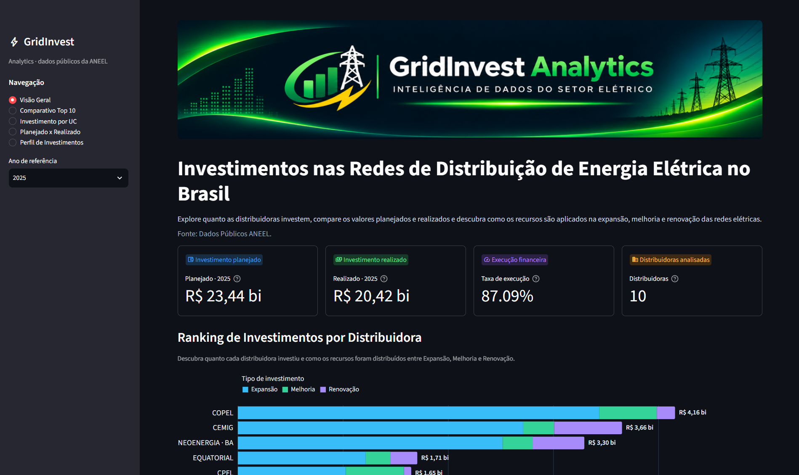
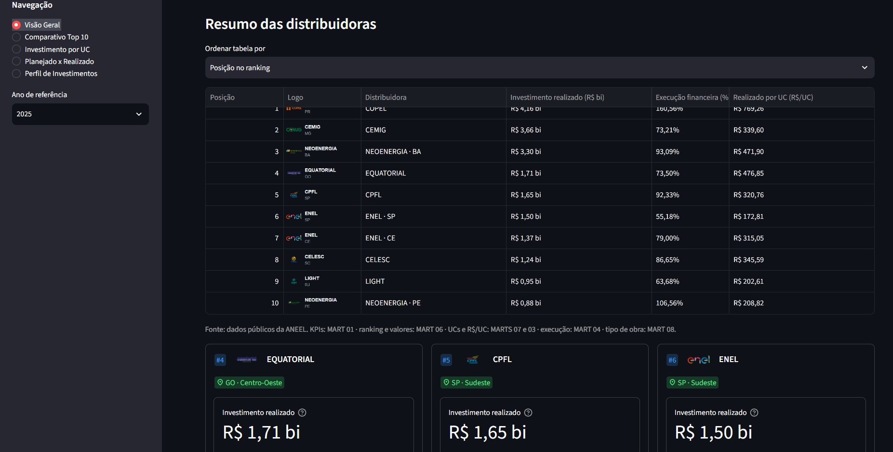
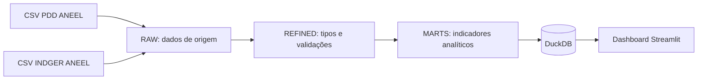

# GridInvest Analytics | Pipeline de Dados e Dashboard

Pipeline de dados e dashboard analítico para explorar investimentos planejados e realizados pelas distribuidoras de energia elétrica no Brasil, a partir de bases públicas da ANEEL.

[](https://gridinvestanalytics.streamlit.app/)

## Prévia do dashboard

<p align="center">
  
</p>

<p align="center">
  
</p>

[](https://www.python.org/)
[](https://duckdb.org/)
[](https://streamlit.io/)
[](https://pandas.pydata.org/)
[](https://altair-viz.github.io/)

## O que é possível analisar?

- Investimentos planejados e realizados pelas distribuidoras.
- Taxa de execução do investimento planejado e diferenças financeiras.
- Comparativo das dez distribuidoras da coorte fixa.
- Investimento realizado por unidade consumidora (R$/UC).
- Composição do investimento por Expansão, Melhoria, Renovação e outros tipos.
- Comparação dos indicadores nos anos de referência disponíveis: 2023, 2024 e 2025, selecionados pelo filtro do dashboard.

A coorte é fixa: reúne as dez distribuidoras com mais unidades consumidoras ativas em dezembro de 2025. O dashboard permite selecionar o ano de referência, mas não apresenta uma página independente de série temporal.

## Páginas do dashboard

| Página | O que apresenta |
|---|---|
| **Visão Geral** | Totais planejados e realizados, taxa de execução e quantidade de distribuidoras; ranking financeiro e composição por tipo de investimento. |
| **Comparativo Top 10** | Ranking por investimento realizado por UC, cards individuais e detalhes financeiros das distribuidoras da coorte. |
| **Investimento por UC** | Maiores e menores valores de R$/UC, total de UCs ativas, indicador agregado da coorte, ranking, dispersão e tabela comparativa. |
| **Planejado x Realizado** | Totais, percentual de execução e diferenças; colunas agrupadas e tabela por distribuidora. |
| **Perfil de Investimentos** | Totais e composição por tipo, participação por categoria e comparação entre distribuidoras. |

As descrições refletem as páginas implementadas. As consultas usam os MARTS descritos na especificação em [`specs/dashboard.md`](specs/dashboard.md).

## Arquitetura



- **RAW** recebe os arquivos de origem sem substituir seus valores.
- **REFINED** converte campos definidos pelo projeto e registra valores nulos, inválidos e situações que precisam de revisão.
- **MARTS** aplica regras analíticas e prepara as tabelas consumidas pelo dashboard.
- **Dashboard** consulta o DuckDB em modo somente leitura. No modo local padrão, usa `gridinvest.duckdb`; no Streamlit Community Cloud, pode usar o banco reduzido de publicação.

As consultas preservam separados os escopos nacional e `top10`. Valores ausentes ou inválidos não são tratados como zero; zero válido permanece distinto de indisponibilidade. R$/UC representa intensidade de investimento por unidade consumidora, não eficiência operacional nem valor recebido individualmente pelo consumidor.

## Fontes e licença dos dados

As fontes usadas pelo pipeline são conjuntos públicos da ANEEL:

- [PDD — Plano de Desenvolvimento da Distribuição](https://dadosabertos.aneel.gov.br/dataset/pdd)
- [INDGER — Indicadores Gerenciais da Distribuição](https://dadosabertos.aneel.gov.br/dataset/indger-indicadores-gerenciais-da-distribuicao)
- [INDGER — Dados Comerciais (CSV)](https://dadosabertos.aneel.gov.br/dataset/indger-indicadores-gerenciais-da-distribuicao/resource/fd10c9d4-cb76-4020-a322-e79afb13eaf7)

As páginas dos conjuntos indicam a [Open Data Commons Open Database License (ODbL) 1.0](https://opendatacommons.org/licenses/odbl/1-0/). Atribuição dos dados: **ANEEL — PDD e INDGER, Dados Comerciais**. A ANEEL não endossa este projeto. A redistribuição de bases derivadas deve observar as condições de atribuição e compartilhamento da ODbL; consulte o texto da licença para os termos completos. O banco de publicação inclui um aviso de atribuição e comentários de metadados com as fontes e a licença.

## Tecnologias

| Ferramenta | Função no projeto |
|---|---|
| [Python](https://www.python.org/) | Implementação do pipeline, acesso aos dados, regras de análise e aplicação. |
| [uv](https://docs.astral.sh/uv/) | Gerenciamento do ambiente e das dependências, registradas em `pyproject.toml` e `uv.lock`. |
| [DuckDB](https://duckdb.org/) | Banco analítico local e de publicação; o dashboard abre as conexões em modo somente leitura. |
| SQL | Construção das tabelas MARTS. |
| [Streamlit](https://streamlit.io/) | Interface interativa do dashboard. |
| [Pandas](https://pandas.pydata.org/) | Preparação e apresentação tabular dos dados. |
| [Altair](https://altair-viz.github.io/) | Construção dos gráficos interativos. |
| [pytest](https://docs.pytest.org/) | Testes automatizados do pipeline, banco e dashboard. |
| [Ruff](https://docs.astral.sh/ruff/) | Verificações estáticas do código Python. |

## Estrutura do repositório

```text
assets/logos/       Logo institucional e logos das distribuidoras
dashboard/          Aplicação Streamlit, páginas, consultas e componentes visuais
pipeline/           Ingestão e transformações RAW, REFINED e MARTS
raw/                CSVs de origem locais; não versionados
scripts/            Geração e validação do banco reduzido para publicação
specs/              Especificações do pipeline e do dashboard
sql/marts/          Consultas SQL que constroem os MARTS
tests/              Testes automatizados
artifacts/deploy/   Artefatos locais de publicação; ignorados pelo Git
```

## Executar localmente

### Pré-requisitos

- Python 3.12 ou superior
- [uv](https://docs.astral.sh/uv/)

Na raiz do repositório, instale as dependências do projeto e do grupo de desenvolvimento:

```powershell
uv sync --all-groups
```

### Abrir o dashboard

O modo local padrão procura o banco de desenvolvimento `gridinvest.duckdb` na raiz do repositório e não realiza download:

```powershell
uv run python -m streamlit run dashboard/app.py
```

### Executar o pipeline

Obtenha os CSVs nos portais oficiais da ANEEL e salve-os localmente com estes nomes:

- `raw/pdd-distribuicao-aneel.csv`
- `raw/indger-dados-comerciais.csv`

O projeto não baixa esses arquivos automaticamente. Na raiz do repositório, execute as etapas na ordem abaixo:

```powershell
uv run python -m pipeline.ingestao
uv run python -m pipeline.ingestao_indger
uv run python -c "from pipeline.refined import transformar_pdd, transformar_indger; transformar_pdd(); transformar_indger()"
uv run python -c "from pipeline.marts import executar_mart_01, executar_mart_02, executar_mart_03, executar_mart_04, executar_mart_05, executar_mart_06, executar_mart_07, executar_mart_08; [f() for f in (executar_mart_01, executar_mart_02, executar_mart_03, executar_mart_04, executar_mart_05, executar_mart_06, executar_mart_07, executar_mart_08)]"
```

### Testes e Ruff

```powershell
uv run python -m pytest
uv run ruff check .
```

## Banco DuckDB e publicação

O banco `gridinvest.duckdb` é gerado localmente pelo pipeline, não é versionado e **não deve ser adicionado ao repositório**. Ele contém dados das camadas RAW e REFINED, que não são necessárias para o dashboard publicado.

Para gerar o banco reduzido usado na publicação:

```powershell
uv run python scripts/build_dashboard_db.py
```

O script lê o banco de origem em modo somente leitura e gera `artifacts/deploy/gridinvest_dashboard.duckdb`, junto com o aviso `gridinvest_dashboard.ATTRIBUTION.md`. O artefato contém apenas as tabelas MARTS selecionadas para o dashboard, sem as camadas RAW e REFINED. A pasta `artifacts/` e arquivos DuckDB são ignorados pelo Git.

### Streamlit Community Cloud

O dashboard está publicado em [gridinvestanalytics.streamlit.app](https://gridinvestanalytics.streamlit.app/). O repositório é [alexscosta90/gridinvest_analytics](https://github.com/alexscosta90/gridinvest_analytics).

O banco local de desenvolvimento não é enviado ao Cloud. Para atualizar os dados publicados:

1. Gere e valide localmente o banco reduzido e o aviso de atribuição.
2. Anexe ambos a uma GitHub Release do repositório.
3. Configure nos Secrets do app no Streamlit Community Cloud a URL HTTPS do asset do banco e o SHA-256 do arquivo publicado.

O README não fixa uma URL de release: use a URL real do asset da release criada.

| Variável | Funcionamento |
|---|---|
| `GRIDINVEST_DB_URL` | URL HTTPS do banco reduzido. Quando definida, o app baixa o arquivo para um diretório temporário fora do repositório. |
| `GRIDINVEST_DB_SHA256` | Hash SHA-256 esperado em hexadecimal; usado para validar o arquivo baixado e obrigatório quando `GRIDINVEST_DB_URL` está configurada. |
| `GRIDINVEST_DB_PATH` | Caminho local opcional para selecionar outro banco, como `artifacts/deploy/gridinvest_dashboard.duckdb`. Não inicia um download. |

Sem `GRIDINVEST_DB_URL` e `GRIDINVEST_DB_PATH`, o app usa `gridinvest.duckdb` da raiz do projeto e não baixa arquivos. No Cloud, configure `GRIDINVEST_DB_URL` e `GRIDINVEST_DB_SHA256` como Secrets de nível raiz. Em todos os modos, o dashboard abre o banco em modo somente leitura.

Para testar localmente o banco reduzido antes da publicação:

```powershell
$env:GRIDINVEST_DB_PATH = (Resolve-Path .\artifacts\deploy\gridinvest_dashboard.duckdb).Path
uv run python -m streamlit run dashboard/app.py
```

## Período e limitações

- O filtro do dashboard oferece os anos de 2023 a 2025; o ano inicial selecionado é 2025.
- A coorte das dez distribuidoras é definida pelas unidades consumidoras ativas de dezembro de 2025 e permanece fixa ao selecionar outros anos.
- A disponibilidade e o formato dos dados dependem das publicações da ANEEL. Os CSVs não acompanham o repositório e precisam ser obtidos separadamente para executar o pipeline.
- Ausências, duplicidades, valores inválidos ou cobertura incompleta podem tornar indicadores indisponíveis. O dashboard sinaliza essas situações em vez de assumir zero.
- UF e região são referências principais da concessão e não representam a lista completa de municípios atendidos.
- R$/UC é uma razão entre investimento e unidades consumidoras; não deve ser interpretado isoladamente como eficiência operacional.
